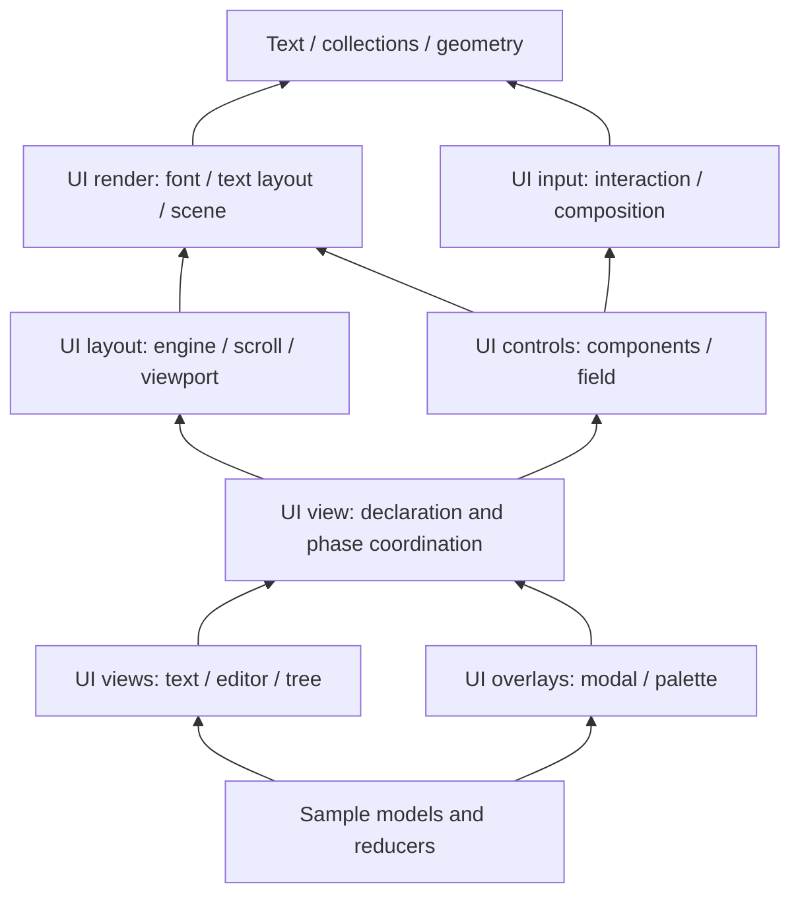

# Module and native boundaries

The module path describes a capability, not a sample application. Goose import
paths mirror files: `lab.net.http` resolves to `lib/lab/net/http.goose`. Goose
namespaces remain single identifiers, so the matching namespace is `lab_net_http`.

## Reusable code

- `collections` contains storage structures without native handles.
- `text` contains byte/Unicode operations and diff metadata without fonts or UI.
- `json` contains parsing/editing and the separately linked file adapter.
- `io`, `fs` and `net` expose native services with explicit ownership.
- `git` composes process/file services; it does not depend on widgets or a renderer.
- `document` owns editing, Undo and file/workspace lifecycle independently of UI.
- `ui` composes these models with platform input, layout and painting.

The subdirectories are capability groups, not a promise that every module in a
group has identical dependencies. For example `document.model` is pure Goose;
`document.file` uses asynchronous filesystem jobs. `json.codec` is pure Goose;
`json.file` needs the synchronous native file adapter. Import the narrower module
and link only the native capabilities needed by reachable code.

## UI composition

`ui.geometry` is shared by layout, input and painting. `ui.render.font` owns
shaping/rasterization; `ui.render.text_layout` retains caret/layout data and
`ui.render.scene` owns GPU drawing. Layout and controls use these lower-level
primitives. `ui.view` coordinates the execution phases for an application.

An arrow denotes use of a capability; individual imports are authoritative.
The diagram omits edges that do not explain the main authoring boundary.
`ui.command` is a command catalog and ranking model, not a GPU component.
Layout, input resolution and painting execute separately. Stable IDs connect
the phases; the frame driver delivers actions in platform event order.

## Native code

Native paths mirror the service boundary, with one canonical root include path.
For example `#include "net/http/http.h"` is the plain C HTTP API; the neighboring
`http_glue.h` adapts generated Goose slices/builders. Only generated application
C includes glue through `native/goose_lab.h`.

`native/io/types.h` contains portable I/O codes and a synchronous byte-sink type.
Filesystem job state machines depend on those types and libuv, not on the loop's
handle registry. Their implementation archive is `goose_lab_fs_jobs`; it is not
a public Goose feature. `goose_lab_loop` owns the shared registry and drives
those jobs, process streams, timers and watches. Keep that resource ownership
in one place even though the implementations occupy different directories.

`native/fs/internal` and `native/ui/text/internal` are implementation details.
Native public headers must not include these directories. Unicode properties
are generated once from the pinned inputs for both Goose and native text.

The scene's byte-comparison cache is a separate `goose_lab_scene` archive. It
does not link FreeType, HarfBuzz or SDL. The font archive is `goose_lab_text`;
layout links it for measurement. `goose_lab_gui_program` combines layout,
scene cache and Goose `gfx`. Text-only consumers can link `goose_lab_text`
without the scene cache. `goose_lab_path` provides native absolute-path handling;
the loop links it as part of its filesystem service composition.

Native target declarations live beside the service groups in `native/*/CMakeLists.txt`.
Pinned dependency configuration lives in `cmake/NativeDependencies.cmake`; common
owned-code compile policy lives in `cmake/NativeLibraries.cmake`; optional font
defaults live in `cmake/Fonts.cmake`.

## Applications

Each directory under `samples` owns its application's entry point and models.
The workbench groups its editor, workspace and Git pages under `samples/workbench`.
Imports such as `workbench.editor.workspace` use namespace `app_editor_workspace`.
These application namespaces are intentionally separate from `lab_*` libraries.
Reusable library builds do not add `samples` or `tools` as module roots and never
import application modules. `tests/module_paths.py` checks that boundary.

The workbench owns one renderer and search worker. Its two resizable page values
stay in separate caller variables, coordinated by a fixed-size state and borrowed
references; see [workbench composition](apps/workbench.md#composition-and-ownership).
Component launchers are test-only (`tests/support`); profiling is opt-in under
`tools/ui`.
